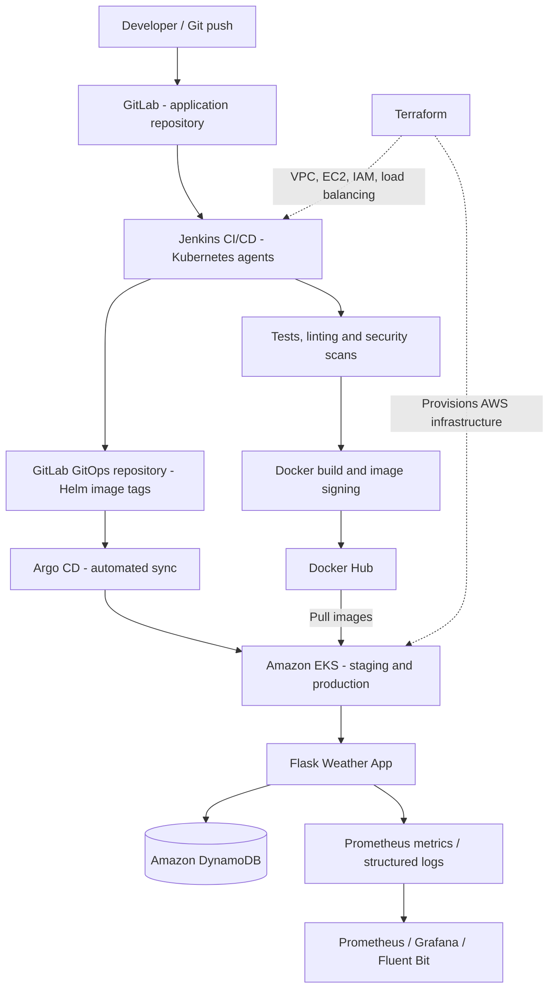

# AWS Cloud-Native Weather App — End-to-End DevOps Platform

**Terraform · AWS · Jenkins · GitLab · Docker · Amazon EKS · Helm · Argo CD · Prometheus · Grafana**

## Overview

An end-to-end DevOps engineering project that demonstrates infrastructure provisioning, continuous integration, container security, Kubernetes orchestration, GitOps-based delivery, and observability on AWS.

The workload is a **Python Flask weather application** that displays location-based forecasts, can save weather data to **Amazon DynamoDB**, and exposes application metrics for Prometheus. The main focus of this project is the platform and automated delivery workflow around the application.

> **Repository note:** This public GitHub repository is a consolidated portfolio snapshot of three projects originally maintained in GitLab. The included Jenkins pipeline still references the original GitLab source and GitOps repositories; it is not automatically connected to this GitHub mirror.

## Architecture



## Technology Stack

| Area | Technologies |
| --- | --- |
| Cloud and networking | AWS EC2, VPC, IAM, EKS, ALB/NLB, Route 53, ACM, DynamoDB, S3 |
| Infrastructure as Code | Terraform |
| CI/CD and source control | Jenkins, GitLab, Git |
| Containers and orchestration | Docker, Docker Hub, Kubernetes, Helm |
| GitOps | Argo CD |
| Security checks | Trivy, Semgrep, Cosign |
| Observability | Prometheus, Grafana, Fluent Bit |
| Application | Python, Flask, Gunicorn, pytest |

## Key Engineering Work

### 1. AWS Infrastructure as Code

- Provisioned modular AWS resources with **Terraform**.
- Designed a **VPC** with public and private subnets across two Availability Zones.
- Configured EC2-based supporting services, IAM, security groups, application load balancing, DNS, TLS certificates, and an **Amazon EKS** cluster.
- Used Terraform configuration and modules to keep infrastructure changes reproducible.

### 2. Jenkins CI/CD Pipeline

- Ran Jenkins builds with **dynamic Kubernetes agents**.
- Automated dependency installation, **pytest** tests, Pylint checks, Docker builds, and application smoke tests.
- Added security checks using **Trivy** (dependencies, Dockerfile, container image), **Semgrep** static analysis, and **Cosign** image signing and verification.
- Pushed tagged container images to **Docker Hub** and updated the corresponding image tag in the GitOps configuration.
- Used branch-aware image versioning: `main` and `develop` for staging; versioned release tags for production.

### 3. Kubernetes and GitOps

- Deployed the weather application to **Amazon EKS** using a reusable **Helm chart**.
- Maintained separate staging and production Helm values, with configurable image tags, replica counts, and services.
- Used **Argo CD** to synchronize Kubernetes desired state from Git, including automated reconciliation and self-healing.
- Configured service exposure, application health checks, and supporting platform workloads.

### 4. Monitoring and Troubleshooting

- Used **Prometheus** and **Grafana** for monitoring and dashboards.
- Exposed application metrics at `/metrics`, including HTTP request counts and durations.
- Implemented structured request logging with request IDs to help trace failures.
- Used **Fluent Bit** for log collection and forwarding.

## Repository Structure

```text
weather-app-devops/
├── app/                 # Flask application, Dockerfile, Jenkinsfile, tests
├── infrastructure/      # Terraform modules and AWS resource definitions
├── gitops/              # Helm chart, Argo CD applications, platform manifests
└── .gitignore           # Excludes local state, credentials, and private keys
```

## CI/CD and Deployment Flow

1. A code change is pushed to the original **GitLab application repository**.
2. **Jenkins** runs automated quality and security checks.
3. Jenkins builds, tests, signs, and publishes a versioned **Docker image**.
4. Jenkins updates the image tag in the original **GitOps repository**.
5. **Argo CD** detects the GitOps change and reconciles the target EKS environment.
6. **Prometheus, Grafana, and logs** support verification and troubleshooting.

## Run the Application Locally

From the repository root, with Docker installed:

```bash
git clone https://github.com/ameenser/weather-app-devops.git
cd weather-app-devops

docker build -t weather-app:local ./app
docker run --rm -p 8000:8000 weather-app:local
```

Open **http://localhost:8000**. The application requires network access to retrieve forecasts. AWS-backed features such as saving weather data to DynamoDB require appropriate AWS permissions and resources.

## Infrastructure and Deployment Notes

- The `infrastructure/` directory contains Terraform configuration, but deploying the full stack requires your own AWS account, reviewed variable values, IAM permissions, certificates, credentials, and supporting resources.
- **Do not run `terraform apply` against the example configuration without reviewing and adapting it.** AWS resources can incur charges.
- Helm configuration is under `gitops/charts/weather-app/`, including `values-staging.yaml` and `values-prod.yaml`.
- The GitHub repository serves as a **portfolio reference**; the pipeline and Argo CD configuration still target the original GitLab setup. Update those references to operate a fresh installation.
- No live application availability or production service-level guarantee is implied by this repository.

## Security

Secrets, signing keys, local environment files, and Terraform state files must **never be committed**. The repository uses `.gitignore` patterns for common sensitive files. For a new deployment, supply credentials through an appropriate secrets-management mechanism rather than hardcoding them. Review all example configuration values before reuse.

## Author

**Ameen Serhan** — DevOps / Software Automation Engineer  
[GitHub](https://github.com/ameenser) · [LinkedIn](https://www.linkedin.com/in/ameen-serhan-231a78170/)
